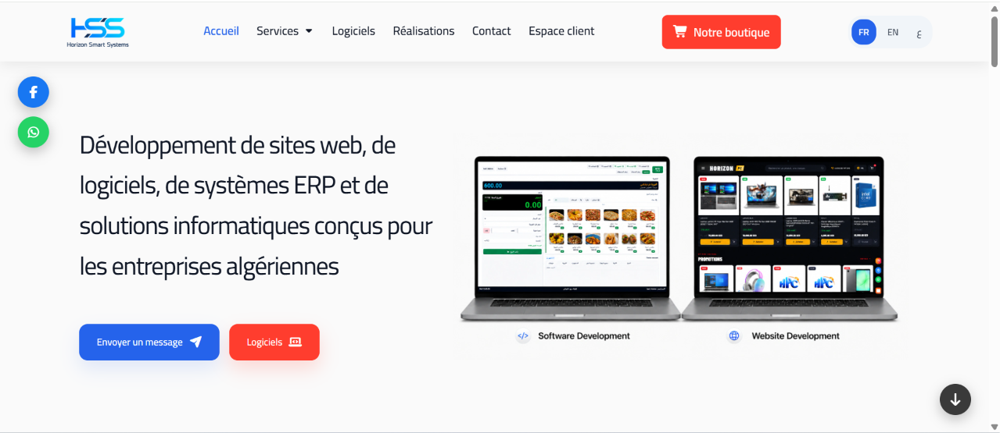
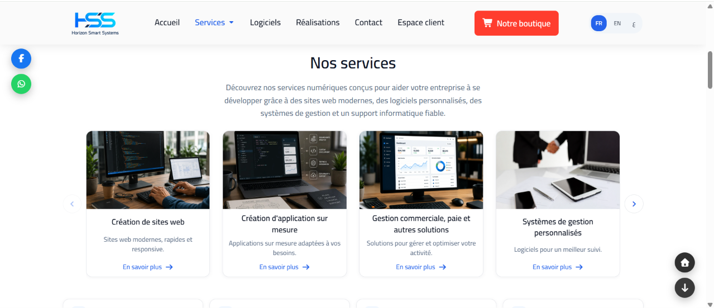
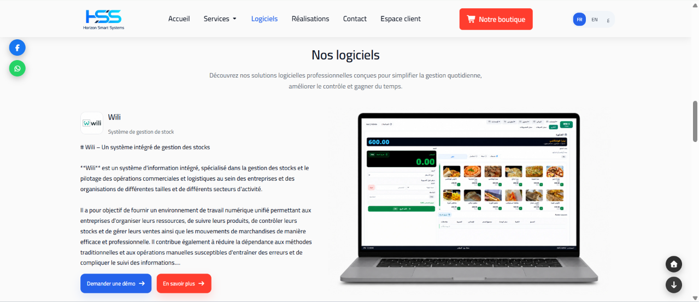

# Horizon Smart Systems

Horizon Smart Systems is a multilingual corporate web platform, digital store, and customer portal developed with Laravel 11. The application showcases IT services, custom software, ERP systems, and digital subscriptions, while offering an interactive space for clients and administrators.

---

## Home Page Overview

The landing page is designed to present company services, software products, and company achievements with support for Arabic, French, and English.

### Hero Section
The main hero section introduces the company, highlights core offerings, and provides quick navigation actions.



### Services Section
Displays primary services and secondary solutions, including web development, tailor-made applications, business management tools, and IT support.



### Software Section
Presents proprietary software solutions such as the Wili management system, detailing features, system overview, and direct contact options.



---

## Key Features

### Multilingual Support
- Seamless switching between Arabic (RTL), French, and English.
- Localized URL routing and slug generation for search engine optimization.
- OpenGraph tags and JSON-LD schema metadata for structured search visibility.

### Digital Store
- Product catalog covering software licenses, subscriptions, gift cards, and game keys.
- Search, category filtering, and sorting based on product priority.
- Direct order placement form with customer contact details and order status tracking.

### Customer Portal
- Authenticated client area using username and password.
- Access to software demo environments.
- Direct messaging and customer support communication with administrators.

### Administration Dashboard
- Role-based permissions for admin, operator, and customer accounts.
- Management of landing page content, services, software entries, and achievements.
- Order request processing and customer communication logs.
- System activity auditing for data modifications and user sessions.

---

## Technology Stack

- Backend: PHP 8.3, Laravel 11
- Database: MySQL / MariaDB 10.4
- Frontend: Blade templates, modular CSS, JavaScript, Swiper.js
- Tooling: Composer, Vite, Laravel Pint
- Containerization: Docker, Docker Compose

---

## Getting Started

### Using Docker (Recommended)

Run the development environment:
```bash
docker compose -f docker-compose.dev.yml up -d --build
```
The application will be accessible at http://localhost:8000.

Run the production environment:
```bash
docker compose -f docker-compose.prod.yml up -d --build
```
The application will be accessible at http://localhost (port 80).

### Local Setup

1. Install Composer dependencies:
   ```bash
   composer install
   ```

2. Set up the environment configuration:
   ```bash
   cp .env.example .env
   php artisan key:generate
   ```

3. Run migrations and database seeders:
   ```bash
   php artisan migrate --seed
   ```

4. Start the local server:
   ```bash
   php artisan serve
   ```

---

## Code Quality

To verify code syntax and formatting:

- Check formatting:
  ```bash
  ./vendor/bin/pint --test
  ```
- Automatically fix formatting:
  ```bash
  ./vendor/bin/pint
  ```

